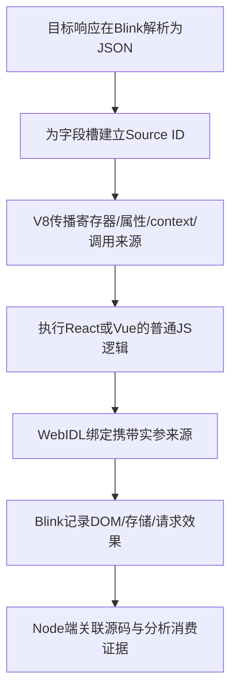

Mockingbird 专用 V8/Chromium 追踪浏览器可行性与改造设计，2026-09-14

**结论：技术上可行，并且在接受专用浏览器的前提下，值得作为主要验证路线。建议先做“编译期位置表 + Ignition 解释执行中的槽位来源状态 + 必要内建操作 + Blink 响应/消费桥接”，逐步替代网页侧的基本类型装箱。**

这仍然是动态数据流追踪：来源放在引擎的旁路状态中，业务值保持原始值。目标网页的JavaScript文本、变量类型和公开函数参数不需要为追踪而改写。代价是需要维护自己的V8/Blink补丁，并验证其执行、GC和异步生命周期；不能理解为改一个C++ getter就覆盖全部JavaScript。

本次完成官方源码核查、现有补丁审查和原版V8字节码观察。没有下载完整Chromium/V8 checkout，没有编译定制引擎或浏览器，没有证明修改版性能和React/Vue全面兼容。下文“建议增加”“影子状态”“TraceUse”“TraceBindingScope”均为设计，非上游已有能力。

**源码基线与证据范围。**

Chromium固定为 `20285b48b0e8a51f39dd0babb7ddd6a0a8152e58`。其DEPS中的V8 revision为 `745ef8ec2d84974b86dedad4ffa2bcf345fe1e7b`，版本宏15.5.31.0。实际构建应使用这个匹配关系，不拼接两个仓库各自的main。[Chromium DEPS](https://github.com/chromium/chromium/blob/20285b48b0e8a51f39dd0babb7ddd6a0a8152e58/DEPS)

V8机制最初在main快照 `736a2cbec441e85b68c742215d15318abfeae707`（15.5.0.0）核查；随后对本文涉及的11个关键文件逐字节比较，确认与DEPS所固定V8相同，包括interpreter-generator、bytecode-generator、bytecodes、flags、interpreter-assembler、bytecode-array-builder、bytecode-register-optimizer.h、source-position、bytecode-array、script、ast。下面优先引用匹配Chromium的V8版本。

本机字节码实验使用原版Node26.0.0所带V8 14.6.202.33-node.19。它只证明该本机版本的字节码现象；不是上述源码版本的运行验收。记录见[字节码实验与版本信息](/Users/sumorile/Desktop/Mockingbird-JS/NodeServer/docs/v8-engine-evidence.json)。

**“在使用变量时拿到信息”需要先明确两种精度。**

一种是执行操作级：哪个响应字段被读取，结果经过哪些实际运算/存储/调用，最终到达哪里。这可以围绕解释器真实的寄存器、累加器和内存槽实现。

另一种是源码引用级：源码中每次执行到标识符a、alias等都各留一条事件。编译器可能复用累加器或删除冗余移动，因此仅跟踪实际字节码不一定逐一出现这些源码读取。若需要这种精度，应在编译时生成明确的TraceUse(siteId, slot)操作并保证不会被相应优化消除。

V8的 `VariableProxy` 是编译期AST中的变量引用，不是JS Proxy，也不是运行时的值访问回调。`VisitVariableProxy/BuildVariableLoad` 按local、parameter、context、global、module等类别生成代码。在这里可以登记位置或生成运行时记录代码，但在编译时打印日志不等于观测每次实际执行。[VariableProxy与变量加载生成](https://github.com/v8/v8/blob/745ef8ec2d84974b86dedad4ffa2bcf345fe1e7b/src/interpreter/bytecode-generator.cc#L4679-L4834)

同样，`IGNITION_HANDLER` 中的C++是生成解释器handler的代码；直接插入fprintf可能只在生成阶段执行。需要由assembler发出实际运行的记录指令或调用。[handler生成机制](https://github.com/v8/v8/blob/745ef8ec2d84974b86dedad4ffa2bcf345fe1e7b/src/interpreter/interpreter-generator.cc#L46-L66)

**来源应跟随一次值所在的槽位，不应只挂在“值对象”上。**

假设接口返回 `{a:0,b:0,c:false,d:false}`。0可能是Smi即时值，false是共享值；相同内容字符串也可能共享内部表示。若用0、false、字符串内容或共享heap对象身份作为唯一来源键，就会把不同字段混在一起。建议采用下面的旁路状态：

| 业务值所在位置 | 来源状态的键 |
|---|---|
| 当前累加器 | 执行帧ID + accumulator |
| 局部变量、临时值、参数寄存器 | 执行帧ID + register index |
| 闭包/脚本context槽 | GC感知的context身份 + slot index |
| 对象数据属性、数组元素 | GC感知对象身份 + 逻辑属性键/元素索引 + 写入版本 |
| 调用实参、receiver、返回 | 动态调用实例 + 对应位置 |
| Promise结果、暂停的async/generator状态 | 持久化的continuation/reaction实例 + 值槽 |

Source ID使用request/response occurrence + JSON路径。派生值使用独立event/node ID及父边，保留实际操作种类。字段标签不能附着在false单例或全局字符串内容上；原值始终按V8本来的语义执行。

例如解释器执行读取response.score时，把该属性槽的来源复制到累加器来源槽；Star把累加器来源复制给寄存器；AddSmi计算原本的加法，并使结果来源依赖原操作数；Return把来源交回调用方。重新写入常量必须清除旧来源，否则会出现残留污点。相关值为空来源时可以减少日志，但不能跳过必要的清除操作。

GC会移动对象，因此不能长期以裸堆地址作身份。需要使用V8可重定位/弱引用机制或引擎内部GC感知表，并明确回收逻辑，避免来源记录把所有响应对象永久保活。[V8 handles与GC](https://v8.dev/docs/embed#handles-and-garbage-collection)

**第一版建议限制在Ignition，具体改动点已经能定位。**

Ignition是V8的寄存器式解释器，适合先验证槽位传播设计。[官方介绍](https://v8.dev/docs/ignition)

| 覆盖类别 | 已核查的真实位置 | 拟议操作 |
|---|---|---|
| 寄存器/累加器 | interpreter-generator.cc的Ldar、Star、Star0、Mov | 复制/清除来源；记录需要的读取和赋值事件 |
| context | LdaContextSlot*、StaContextSlot*等 | 对闭包实际context槽传递来源 |
| 属性/元素 | GetNamedProperty、GetKeyedProperty、SetNamedProperty、SetKeyedProperty、Define* | 对真实成功读取/写入更新来源；另处理getter、setter、Proxy与原型语义 |
| 调用/返回 | InterpreterJSCallAssembler、CallJSAndDispatch、Return | 实参与receiver旁路传递、进入callee、返回到caller累加器 |
| 运算/比较 | BinaryOp*、Smi特化、Test* | 按实际操作数建立数据依赖，保留原转换与异常 |
| 条件控制 | JumpIf*及比较结果 | 记录已执行条件与实际分支；不虚构另一支被访问 |

源码入口：[寄存器](https://github.com/v8/v8/blob/745ef8ec2d84974b86dedad4ffa2bcf345fe1e7b/src/interpreter/interpreter-generator.cc#L134-L174)、[context](https://github.com/v8/v8/blob/745ef8ec2d84974b86dedad4ffa2bcf345fe1e7b/src/interpreter/interpreter-generator.cc#L256-L385)、[属性](https://github.com/v8/v8/blob/745ef8ec2d84974b86dedad4ffa2bcf345fe1e7b/src/interpreter/interpreter-generator.cc#L598-L799)、[调用交接](https://github.com/v8/v8/blob/745ef8ec2d84974b86dedad4ffa2bcf345fe1e7b/src/interpreter/interpreter-assembler.cc#L842-L890)。

这里有两个不能漏的快速路径。属性读取会直接进入LoadIC/KeyedLoadIC，因此只改Runtime_GetProperty不够。短Star还可能由前一个handler中的StarDispatchLookahead/InlineShortStar直接执行，绕开独立Star0 handler；来源更新应覆盖共同存储辅助层或这个内联路径。[短Star内联](https://github.com/v8/v8/blob/745ef8ec2d84974b86dedad4ffa2bcf345fe1e7b/src/interpreter/interpreter-assembler.cc#L1344-L1399)

调用也是tail-dispatch，不能假设在C++调用函数后添加一行代码，就能在所有JS返回后收到通知。需要设计完整的shadow frame push/enter/return/throw协议，不能用一个全局lastSource应付重入。

这些条目是主要入口，不是完整JavaScript操作清单。全局/module/lookup槽、常量与literal初始化、delete、迭代器、构造器、异常、生成器等也要登记支持状态。特别是业务getters/setters可能执行其他JS计算，不能为了取来源再读取一次属性。

**关闭JIT是可行的初期范围控制，但不是完整覆盖开关。**

固定V8源码中，jitless约束禁用相关运行时JIT路径，包括Sparkplug、Maglev、TurboFan相关优化，并使正则采用解释路径。Ignition的寄存器等价优化、无效果字节码省略和表达式位置过滤仍有各自的开关，不是jitless自动全关。[jitless约束](https://github.com/v8/v8/blob/745ef8ec2d84974b86dedad4ffa2bcf345fe1e7b/src/flags/flag-definitions.h#L895-L936)、[Ignition及source-position开关](https://github.com/v8/v8/blob/745ef8ec2d84974b86dedad4ffa2bcf345fe1e7b/src/flags/flag-definitions.h#L1134-L1154)

初期研究配置可以评估jitless，加上关闭ignition_reo、noneffectful bytecode elision、expression-position filtering及lazy source positions。配置必须在实际构建版本检查，不能把候选flags当作已通过验收。

本机原版V8实验证明这个区分有实际影响。下面代码：

```js
function responseExample(response) {
  const score = response.score;
  const alias = score;
  return alias + 1;
}
```

仅jitless时，输出5条字节码：GetNamedProperty、Star0、Star1、AddSmi、Return。再关闭三项字节码优化/过滤后，输出9条，出现Ldar a0、Ldar r0、Ldar r1等原来省略的加载；两次均返回42。说明即使没有JIT，源码变量使用与实际字节码也不是简单一一对应。

此外，jitless不会把全部builtins变成JS字节码。数组、字符串、数值转换、JSON、Promise等仍可能执行C++/CSA/Torque生成的原生逻辑，需要传播规则或内部hook。只记录Call事件不能自动知道返回值和副作用依赖什么。[V8 JIT-less说明](https://v8.dev/blog/jitless)

第一版不承诺Wasm、优化tier及OSR/deopt覆盖。后续要恢复Sparkplug，需要生成对应影子操作；再支持Maglev/TurboFan，需要跟随SSA/Phi、内联、寄存器分配、表示转换、OSR和deopt恢复。Turboshaft主要是相关编译阶段，不能画成与TurboFan平行的独立通用执行tier。[Sparkplug](https://v8.dev/blog/sparkplug)、[Maglev](https://v8.dev/blog/maglev)

解释执行也会改变耗时、调度和资源占用，因此行为基线需分成原版正常模式、原版研究flags模式、修改版相同flags模式，先隔离执行模式变化与追踪补丁的影响。性能提升或降低均需实测，不能继承网页侧版本的指标。

**代码、变量名和行列可以关联，但需要编译期位置表。**

推荐在编译时分配siteId，保存script ID/hash、函数ID、操作类型、binding ID与源码位置；运行时事件只携siteId及当前执行实例。一次编译对应多次运行，位置ID不能代替动态事件ID。

现有SourcePosition记录源码offset等信息，BytecodeArray按字节码位置查询到最近源位置，Script可换算行列。这适合基础定位，但不自动给出整个表达式的起止范围，且位置可能被延迟或过滤。[SourcePosition](https://github.com/v8/v8/blob/745ef8ec2d84974b86dedad4ffa2bcf345fe1e7b/src/codegen/source-position.h#L25-L44)、[BytecodeArray位置查询](https://github.com/v8/v8/blob/745ef8ec2d84974b86dedad4ffa2bcf345fe1e7b/src/objects/bytecode-array.cc#L22-L44)、[行列转换](https://github.com/v8/v8/blob/745ef8ec2d84974b86dedad4ffa2bcf345fe1e7b/src/objects/script.cc#L440-L510)

若需要显示 `response.score + 1` 的完整代码，可以在parser/编译阶段补齐所需节点的start/end span，或离线根据记录位置再解析源码以找到表达式。V8 AST并非每个节点都有完整end span，不能假定直接取一个字段即可。拿到的是实际执行的bundle代码；映射回TS、JSX、Vue SFC仍需要对应source map。无需为了做报告而修改这些业务源码。

建议事件结构如下，字段为拟议协议：

```json
{
  "eventId": 128,
  "runId": "run-1",
  "processId": 2,
  "isolateId": 1,
  "contextId": 4,
  "activationId": 37,
  "siteId": 53,
  "operation": "binary:add",
  "parents": [121],
  "sourceIds": ["response-7:/score"],
  "completion": "normal"
}
```

源码与响应快照按实例保存一次；热点路径使用有界缓冲、ID及类型信息，不逐事件执行JSON.stringify、构造Error.stack或回调业务JS。GC/safepoint、异常和记录器重入必须被设计约束。发生丢日志/缓冲溢出时显式标记覆盖缺口。

**响应Source最适合从Blink的JSON入口开始。**

已核查Fetch路径为 Body::json → BodyJsonConsumer::DidFetchDataLoadedString → FromJSONString → v8::JSON::Parse，XHR ResponseJSON也经FromJSONString。适合在解析结果交给业务之前，为数据属性槽建立每个字段的源标签。[Body JSON consumer](https://github.com/chromium/chromium/blob/20285b48b0e8a51f39dd0babb7ddd6a0a8152e58/third_party/blink/renderer/core/fetch/body.cc#L184-L204)、[V8 JSON桥接](https://github.com/chromium/chromium/blob/20285b48b0e8a51f39dd0babb7ddd6a0a8152e58/third_party/blink/renderer/bindings/core/v8/v8_binding_for_core.cc#L814-L823)、[XHR JSON](https://github.com/chromium/chromium/blob/20285b48b0e8a51f39dd0babb7ddd6a0a8152e58/third_party/blink/renderer/core/xmlhttprequest/xml_http_request.cc#L376-L389)

Fetch的Body机制也用于Request和合成Response，必须只把配置选中的目标响应标为Source；来源身份按请求实例与响应generation区分，不能仅用URL。无reviver的新JSON对象可在业务接触前初始化数据槽来源；顶层0/false/null没有对象属性槽，需要标记解析结果与Promise结果/return occurrence，不能在值单例上标记。

JSON consumer自身已延后resolve，所以进入真实Fetch阶段时，Promise/reaction来源交接就是必要能力，不能把所有异步留到最后。XHR responseText在LOADING也可读；text/responseText后再JSON.parse的字段精度需要另一条文本来源到解析槽位的规则。文本经切片、拼接、reviver处理时不能粗暴把整棵JSON统一当作同一个字段来源。

**只改V8不够，必须在WebIDL绑定转换前后接来源。**

JS的 `element.textContent = score` 进入Blink后，score可能已经被转成WTF String。绑定转换中还存在int32直接转字符串及null/undefined特例，不一定经过某个通用JS String函数。普通v8::Value handle也不能区分两次相同Smi的来源。[NativeValueTraits转换](https://github.com/chromium/chromium/blob/20285b48b0e8a51f39dd0babb7ddd6a0a8152e58/third_party/blink/renderer/bindings/core/v8/native_value_traits_impl.h#L240-L304)

建议扩展V8内部callback的实参位置/setter-value来源通道，并修改Blink binding generator，为支持的API生成嵌套安全的TraceBindingScope。先取得本次参数来源，正常执行原WebIDL转换，把来源和转换结果一起交给效果记录。不要手改gen目录的绑定产物，也不要为了追踪重复调用toString/valueOf。转换可能执行用户代码并重入，需要正确处理异常及新增依赖。[绑定参数生成](https://github.com/chromium/chromium/blob/20285b48b0e8a51f39dd0babb7ddd6a0a8152e58/third_party/blink/renderer/bindings/scripts/bind_gen/interface.py#L225-L293)

**React/Vue的目标是连到宿主效果，不要求每层框架代码增加包装对象。**



当React/Vue的JS内部传播和相关内建规则受支持时，它们可以使用原始数字、false和字符串，不再因工具装箱走错children/条件分支，也能减少按每个框架压缩函数名适配的需求。但原生builtins、Promise、绑定转换没有接好时，改版引擎照样可能断链。

一期DOM终点建议选择createTextNode、nodeValue和textContent，再扩展属性、style、value/checked、URL、storage和网络。createTextNode仅创建节点，不证明节点已进入页面；需要保存节点内容来源并在挂接/更新时关联效果。textContent对不同nodeType行为不同，同值写入也可能提前返回；“没有DOM变化”不等于数据无用。[Text创建](https://github.com/chromium/chromium/blob/20285b48b0e8a51f39dd0babb7ddd6a0a8152e58/third_party/blink/renderer/core/dom/document.cc#L1650-L1652)、[textContent实现](https://github.com/chromium/chromium/blob/20285b48b0e8a51f39dd0babb7ddd6a0a8152e58/third_party/blink/renderer/core/dom/node.cc#L2421-L2474)

本方案第一目标是证明到达并成功执行约定的DOM sink，不承诺像素可见性。读取、传播、已执行条件、效果尝试、成功/无变化/异常分别记证据。未接的native调用、序列化和异步路径报告trace-gap，不能用日志停止推导Unused。

structuredClone/postMessage/workers/跨进程需要额外的序列化sidecar。新对象、新isolate不会自动继承原side table。应在真实序列化操作中记录映射，不能额外预遍历再执行一遍getter。[Blink structuredClone](https://github.com/chromium/chromium/blob/20285b48b0e8a51f39dd0babb7ddd6a0a8152e58/third_party/blink/renderer/core/frame/universal_global_scope.cc#L70-L109)

**PanoptiChrome值得参考，旧补丁不适合直接作为完成方案。**

固定审查其官方仓库 `d2ee7626dc4ce549750eca9bce14338604f12199`，基线为V8 11.6.189.2 / Chromium116。它在字节码生成阶段增加运行时观察点，将已求值的值、receiver、位置等传给来源分析，并组合AST标签、对象映射与数据/控制图。[官方版本说明](https://github.com/therahulkanyal/PanoptiChrome/blob/d2ee7626dc4ce549750eca9bce14338604f12199/README.md)

可借鉴的是事件分类、编译位置关联和source/propagation/sink分离。源码审查同时发现了会影响复用的具体问题：动态属性key生成了重复求值；布尔/空值过滤与数组Smi/spread缺口；为身份标签改动通用哈希和字符串缓存；持久handle清理及GC裸地址缓存风险。这些属于源码证据/静态风险，没有运行旧浏览器复现。因此建议按现代V8重新实现槽位来源模型，不直接移植整块补丁。[动态key改写](https://github.com/therahulkanyal/PanoptiChrome/blob/d2ee7626dc4ce549750eca9bce14338604f12199/panoptichrome_patches.diff#L2951-L2964)、[过滤逻辑](https://github.com/therahulkanyal/PanoptiChrome/blob/d2ee7626dc4ce549750eca9bce14338604f12199/panoptichrome_patches.diff#L5419-L5433)

**实施应先用d8验证机制，再构建浏览器链路。**

| 阶段 | 交付内容 | 必须满足的验收 |
|---|---|---|
| 0：d8可观测性 | 固定版本、研究flags、编译site table、真正运行时读取/运算/调用事件 | 循环/重复调用产生不同执行事件；日志关联到正确源码，不是编译时打印 |
| 1：d8来源传播 | accumulator/register/context/property shadow、同步参数/返回、必要运算、GC感知元数据 | 同值不同源、false/0/null、赋值清源、getter只读一次、别名/闭包/异常，源链准确 |
| 2：异步与内建 | Promise/reaction与暂停恢复、String/Number及必要数组/JSON传播 | 异步并发不混源；原生摘要区分receiver/参数/返回/副作用；未知路径给gap |
| 3：Chromium端到端 | DEPS匹配V8、目标Fetch json与XHR json、Blink绑定来源通道、文本DOM效果 | 响应字段→JS传播→DOM成立，顶层primitive与JSON对象都不混源 |
| 4：框架与扩展 | React/Vue挂载/更新、属性/表单/样式、text+JSON.parse、存储/网络 | 正反例、控制分支、未用props、同值更新、离线节点及框架原始行为一致 |
| 后续独立工作 | 序列化/worker/frame/Wasm及JIT tiers | 每项单独建立覆盖和性能证据，不靠“都在修改版浏览器里”推断支持 |

这不是保证所有阶段短期可完成的工期估算。每阶段先有小反例、可重复结果和明确coverage状态，再扩范围。d8没有DOM，所以阶段0/1用测试专用source标记和mock sink验证；不能将d8通过作为浏览器通过。

构建使用V8/Chromium官方depot_tools、GN/Ninja流程；先构建d8缩短引擎修改的验证周期，再按Chromium DEPS集成。NodeServer可以继续保留配置、Playwright交互、日志汇总与分类，将来源事件改从浏览器内部导出；自定义CDP域或批量进程通信是新增设计，现成CDP没有该数据流协议。[V8构建指南](https://v8.dev/docs/build-gn)、[Chromium Mac构建指南](https://chromium.googlesource.com/chromium/src/+/20285b48b0e8a51f39dd0babb7ddd6a0a8152e58/docs/mac_build_instructions.md)

本机只读预检：arm64，可用磁盘约333.6GiB，当前选中的开发目录为CommandLineTools。尚未确认完整Xcode/匹配SDK，未验证构建环境。官方Mac构建要求Xcode/SDK和APFS；不能仅凭现有Node或磁盘空间认为Chromium构建已准备完毕。

在接受专用浏览器这一前提下，建议优先验证阶段0与阶段1：用真实执行点记录源码和来源，先证明原始数字/布尔值、别名与函数传播不需要JS装箱。该结果能决定是否继续投入Blink与框架支持，避免同时修改整个引擎和浏览器后才发现核心来源模型不成立。
