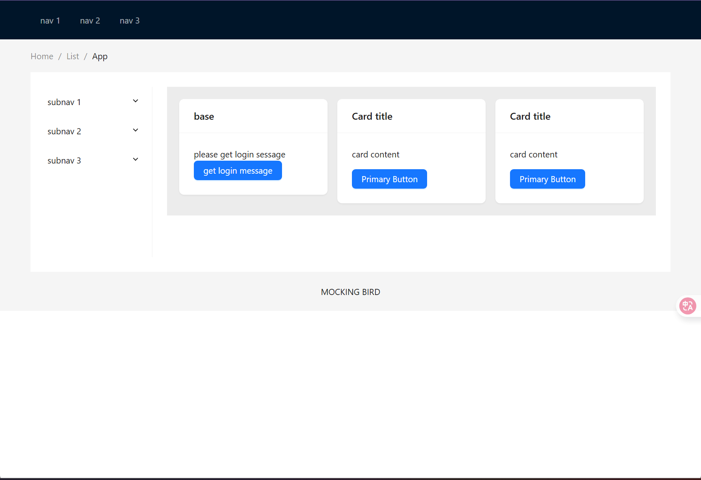
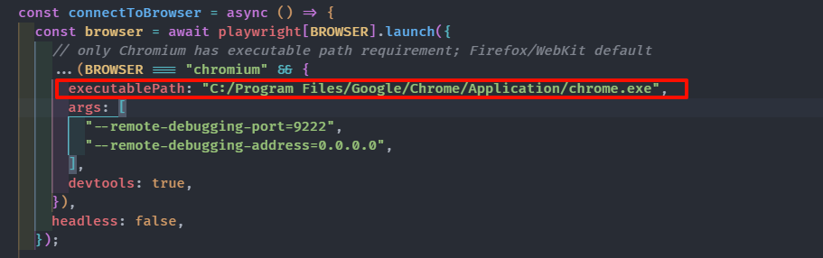
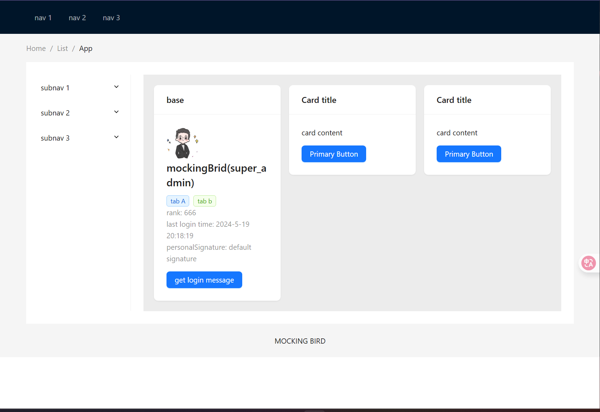
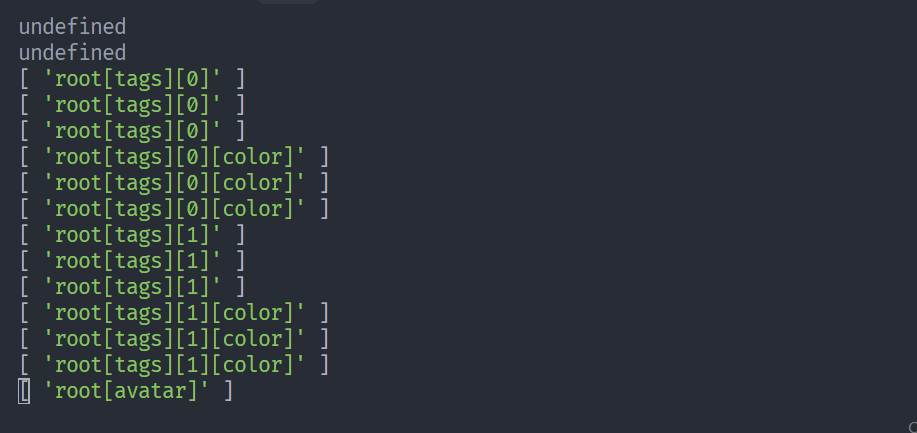
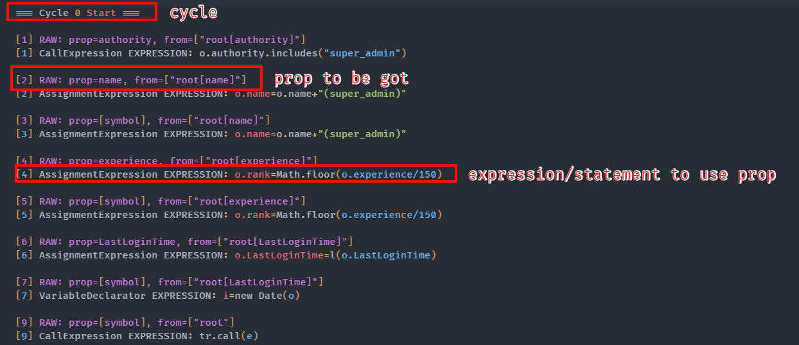

# Mockingbird: A Gray-box Testing Framework for Web APIs

This repository contains the open-source implementation and dataset for the Mockingbird project, a novel framework for gray-box testing of web APIs.

## Directory Structure

This project is organized into the following directories:

- **`/NodeServer`**: The core algorithmic implementation of the Mockingbird framework. This includes the server-side logic for script interception, dynamic instrumentation, and static analysis.

- **`/EDEBench`**: A comprehensive benchmark dataset designed for evaluating web API testing tools. It includes test cases, annotated API specifications, and raw testing logs from our experiments.

- **`/VueDemo`**: A sample front-end application (built with Vue.js) used to demonstrate the capabilities of Mockingbird in a realistic setting.

- **`/FlaskServerDemo`**: A sample back-end server (built with Flask) that provides the web APIs for the `/VueDemo` application.

## Getting Started

Please refer to the `README.md` file within each directory for specific instructions on how to set up and run the components. Start with `/NodeServer` for the main framework.

## An example

- run the Vue and Flask
  

- change the Chrome path
  

- cd NodeServer and run `node ede-killer.js test`

  
  

- The logs are located in the folder `/logs/test/console`
  
